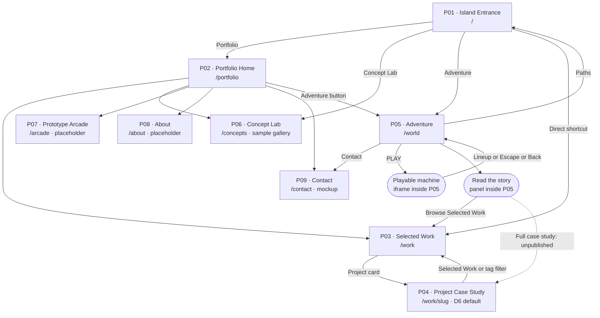
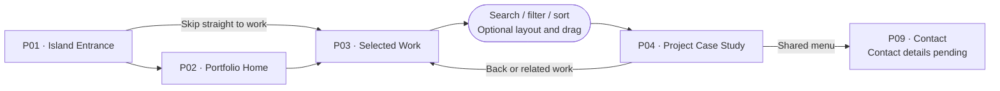
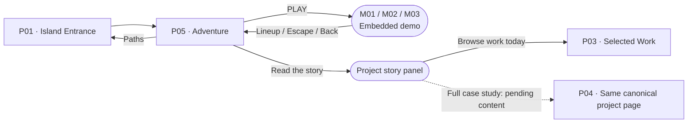

# Portfolio Quest — page map and user journeys

Reference version: 2026-11-15. Describes current local implementation, not a deployment. Use the page IDs below in feedback and future briefs.

## Page names and IDs

| ID | Canonical name | URL | Current status |
|---|---|---|---|
| P01 | Island Entrance | `/` | Main island, Portfolio/Concept Lab/Adventure choices, direct Selected Work and scripted guide |
| P02 | Portfolio Home | `/portfolio` | Approved orange editorial homepage |
| P03 | Selected Work | `/work` | Discovery controls implemented; 12 mock projects in development; no published production projects |
| P04 | Project Case Study | `/work/[slug]` | Seven templates, D6 default; mock case studies development-only |
| P05 | Adventure | `/world` | Three playable prototype demos, grid/carousel, Island/Arcade/Neon |
| P06 | Concept Lab | `/concepts` | Visual gallery; seven development sample pieces, category views and canonical visual-story links |
| P07 | Prototype Arcade | `/arcade` | Placeholder; distinct from the implemented Adventure lineup |
| P08 | About | `/about` | Placeholder; approved biography/resume not published |
| P09 | Contact | `/contact` | Contact mockup and local draft composer; public email/LinkedIn pending |
| P10 | Page Not Found | Any unmatched URL | Custom 404 with Return home → P01 |
| T01 | Island Design Preview | `/quest-preview` | Review route sharing the main island component; not in primary navigation |
| T02 | Destination Comparison Gallery | `/quest-preview/destination-review.html` | Day/night artwork review gallery; links to T01 |

`[slug]` is a project identifier, not a separate template route. D0–D6 are page layouts for P04, not seven additional site sections. `?template=D0` through D6 only work while sample data is enabled. Production sample project URLs return 404.

## Information architecture

Solid arrows are implemented navigation. Dotted Adventure story → case study is a future connection requiring approved published records. Review tools are separate from visitor navigation.

The shared menu on P02/P03/P04/P06/P07/P08/P09 links to Entrance, Portfolio, Selected Work, Concept Lab, Prototype Arcade, About, Contact and Adventure. Brand → Portfolio Home. Footer links to professional sections. These repeated cross-links are omitted from the diagram for readability. P01 and P05 have their own compact controls.

P04 also links to previous, next and related projects in the available project collection; chapter navigation stays on P04. Story panels and playable machines are states inside P05. A machine launch adds an in-page history entry. The three static embeds are:

| ID | Embedded prototype | Static URL |
|---|---|---|
| M01 | Seat Optimizer | `/arcade/P1-seat-optimizer.html?embed` |
| M02 | AI Concierge — scripted demo | `/arcade/P2-ai-concierge.html?embed` |
| M03 | Break the Bot | `/arcade/P3-break-the-bot.html?embed` |

The `/arcade/…html` static files do not make P07 Prototype Arcade a completed discovery page. Five unbuilt Adventure examples are development-only.

## Journey A — professional work

Current limit: development shows mock content; production has no approved project records. Recruiter-to-contact conversion is incomplete because P09 is a contact mockup with local message drafting, awaiting a public email and LinkedIn URL. Dragging is optional and never required to open a project. Tidy up resets the arrangement; dragged order is not persisted or part of the shared URL. Search/filter/sort/layout are represented in the URL.

## Journey B — play, then read

Current limit: project roles, process and outcomes are not approved; the panel discloses this. There are no public Full case study links until a demo has both an assigned `caseStudySlug` and a published project record. No paid/live AI is connected.

## Entrance controls are not new pages

- Settings → Scene set → Current City & Season / New Destination Scenes → Place.
- Day/Night, Season Changes, pause/full screen and camera reset modify the entrance state.
- Avatar → scripted conversation → approved destination link.
- Portfolio/Concept Lab/Adventure buildings → optional camera/character approach → P02/P05. Reduced motion or unavailable WebGL uses direct navigation.
- Cities, seasons and destinations are scenery, not extra URL sections.

## Gaps and owner decisions

1. **P07 versus P05:** Prototype Arcade is empty while Adventure contains playable demos. Decide whether P07 is a conventional catalogue of those same demos; no route merge has been assumed.
2. **Real published content:** supply approved records, images and slugs for P03/P04 and connect M01–M03 to their canonical case studies. Samples must not be mistaken for real work.
3. **P06/P08/P09:** approved concept content, biography/resume and working public contact remain unfinished. P06 has a sample gallery with visual-story views at `/work/[slug]?view=visual`. P09 now has a contact mockup and local draft composer; actual channels are not connected. `/concepts/[slug]` and `/arcade/[slug]` do not exist today.
4. **Experience switching:** Adventure → Paths → Portfolio is implemented; there is no direct Portfolio button in P05's compact header.
5. **External sharing of entrance scenery:** scene selections are state, not stable destination URLs. A direct scene-link feature is not implemented.
6. **Journey QA:** live desktop checks verified search, FinTech filter, clearing, A–Z, both layouts, drag/drop in grid and collage, and Tidy up. Project pages work over HTTP; live project-click/Back, touch, reduced motion and screen-reader journeys remain open.

No code/navigation changes were made to resolve these design/content decisions. This reference records the current connections and missing pieces.
